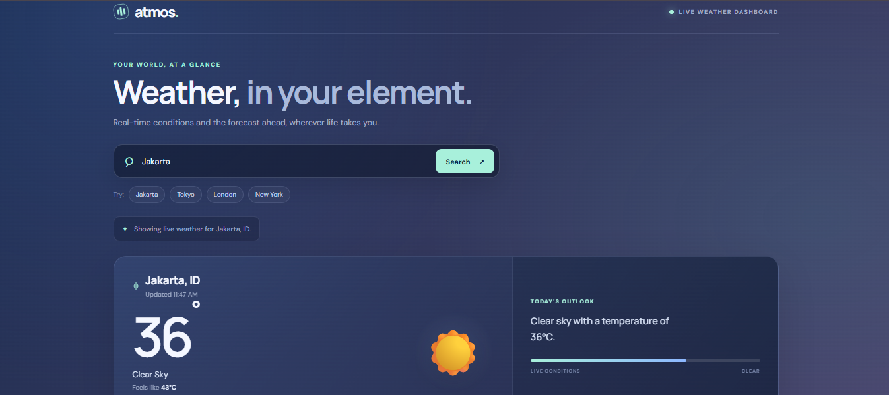

# Atmos — Real-Time Weather Dashboard

A responsive weather dashboard built with **HTML, CSS, vanilla JavaScript, OpenWeatherMap, and Cloudflare Workers**. Atmos displays current weather conditions and a five-day forecast through a clean, responsive interface.

## Live Demo

**Website:** https://chrisjohanes.github.io/datheon-weather-app/

## Screenshots

<!-- Save a screenshot of the deployed GitHub Pages dashboard as:
     screenshots/atmos-dashboard.png
     Then commit the image to this repository. -->



_Screenshot of the live Atmos dashboard._

## Features

- Search for cities worldwide
- Current temperature and feels-like temperature
- Weather conditions, humidity, wind speed, pressure, and visibility
- Five-day forecast cards based on OpenWeatherMap's three-hour forecast data
- Weather icons and condition-based background themes
- Loading, timeout, invalid-city, and network-error states
- Responsive layout for desktop and mobile
- Asynchronous requests using `fetch`, `async/await`, `Promise.all`, and `try/catch`
- OpenWeatherMap API key stored as a Cloudflare Worker Secret, not in browser JavaScript

## Technology Stack

- **Frontend:** HTML5, CSS3, vanilla JavaScript
- **Weather data:** OpenWeatherMap API
- **API proxy:** Cloudflare Workers
- **Hosting:** GitHub Pages
- **Version control:** Git and GitHub

## Project Structure

```text
datheon-weather-app/
├── index.html
├── style.css
├── script.js
├── worker/
│   └── worker.js
├── screenshots/
│   └── atmos-dashboard.png
└── README.md
```

## Architecture Overview

1. A visitor opens the static frontend hosted on GitHub Pages.
2. The frontend sends requests to the Cloudflare Worker for current weather or forecast data.
3. The Worker validates the request origin and endpoint, then calls OpenWeatherMap using the server-side `OPENWEATHER_API_KEY` secret.
4. The Worker returns the weather response to the frontend.

The OpenWeatherMap API key must never be placed in the public frontend code or committed to the repository.

## Deployment Guide

### 1. Configure the Cloudflare Worker

1. Sign in to Cloudflare and open **Workers & Pages**.
2. Create or open your Worker and deploy the contents of `worker/worker.js`.
3. Under the Worker settings, add a **Secret** named `OPENWEATHER_API_KEY` containing your OpenWeatherMap API key.
4. Add a **Text variable** named `ALLOWED_ORIGIN` with the exact frontend origin. For this project, use:

   ```text
   https://chrisjohanes.github.io
   ```

   Do not include the repository path (`/datheon-weather-app/`) or a trailing slash.

5. Save the configuration and deploy the Worker.

### 2. Configure the Frontend

In `script.js`, set `WEATHER_API_BASE` to your deployed Worker URL. For example:

```js
const WEATHER_API_BASE = "https://YOUR_WORKER.YOUR_SUBDOMAIN.workers.dev";
```

Replace the example with your actual Worker URL. The Worker URL is public; the OpenWeatherMap API key is not.

### 3. Deploy the Frontend to GitHub Pages

1. Commit the frontend files to your GitHub repository. Never commit API keys or other secrets.
2. In the repository, open **Settings → Pages**.
3. Select **Deploy from a branch**, choose `main` and `/(root)`, then save.
4. Wait for GitHub Pages to publish the site.
5. Ensure the Worker’s `ALLOWED_ORIGIN` matches the site’s origin exactly. If you use a custom domain, update the variable to that domain’s origin.

### 4. Test the Application

Open the live demo and test the following:

- Search for a valid city, such as `Jakarta`
- Confirm current weather details load
- Confirm the five-day forecast appears
- Search for an invalid city and confirm an error message is shown
- Check the layout at desktop and mobile widths

A direct browser visit to a Worker API endpoint may be rejected by the origin check because the request may not include the expected `Origin` header. Prefer testing through the deployed frontend.

## Add or Update the Screenshot

1. Open the [live Atmos dashboard](https://chrisjohanes.github.io/datheon-weather-app/).
2. Search for a city and wait until the current weather and forecast are visible.
3. Capture a screenshot of the dashboard. On Windows, you can use **Win + Shift + S**.
4. In the repository root, create a folder named `screenshots` if it does not exist.
5. Save the screenshot as `atmos-dashboard.png` inside that folder.
6. Commit and push the screenshot to GitHub. The image will then appear in this README.

## Security Notes

- Never commit API keys, `.env` files, or secrets to a public repository.
- If an API key has been exposed, rotate it in the OpenWeatherMap account and update the Cloudflare Worker Secret.
- The Worker validates the request origin, restricts routes, and validates city input.
- **CORS is not authentication.** Non-browser clients can spoof request headers, so CORS alone does not prevent API abuse.
- For a public production service, consider adding rate limiting or other abuse controls and monitoring provider usage.
- Do not store secrets in frontend JavaScript; browser code is publicly accessible.

## License

No license has been specified for this project yet.
